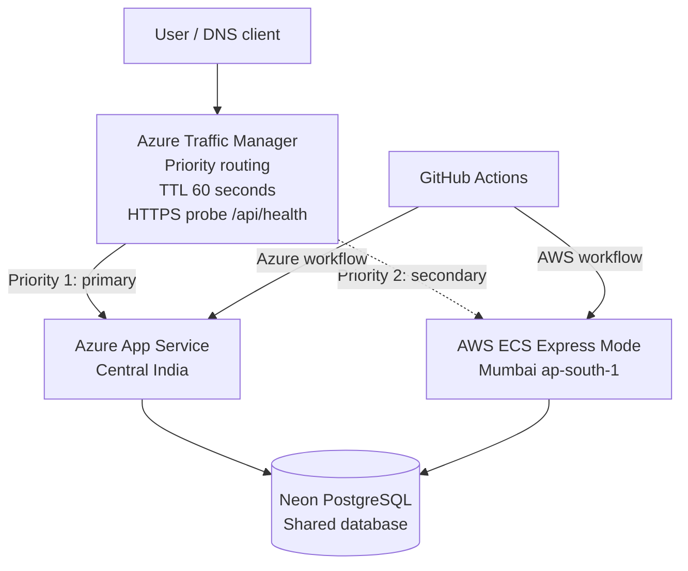

# CloudNote — Multi-Cloud Deployment & Failover Demo

A Next.js notes application deployed to **Azure App Service** and **AWS ECS Express Mode**, with a shared **Neon PostgreSQL** database. GitHub Actions builds, tests, containerizes, and deploys the application to both providers.

> **Scope:** This project demonstrates multi-cloud application deployment, CI/CD, shared-database access, and a manually tested DNS endpoint switch using Azure Traffic Manager. It does not claim measured automatic failover under five minutes. The shared Neon database remains a common dependency, so this is application-tier failover—not independent database HA/DR.

## Live deployments

| Component | URL |
|---|---|
| Azure application | https://cloudnote-f8h2huf8djekewff.centralindia-01.azurewebsites.net |
| Azure health | https://cloudnote-f8h2huf8djekewff.centralindia-01.azurewebsites.net/api/health |
| AWS application | https://cl-04bd4a7ed3c64fd6847753746699c32c.ecs.ap-south-1.on.aws |
| AWS health | https://cl-04bd4a7ed3c64fd6847753746699c32c.ecs.ap-south-1.on.aws/api/health |
| Traffic Manager DNS | https://cloudnote-failover-2026.trafficmanager.net |
| GitHub repository | https://github.com/akash52004/cloudnote-multicloud |

Use the direct Azure and AWS URLs for browser testing. Traffic Manager is DNS-based, not an HTTP reverse proxy. The Traffic Manager hostname is used for DNS endpoint-selection testing; it is not verified as a common browser-facing application URL because a custom domain/host-header setup is not configured for both origins.

## Architecture



### Components

- **Application:** Next.js 15, React 19, Node.js.
- **API:** Notes API for listing, creating, and deleting notes; health API reports status, database connectivity, and provider.
- **Database:** Neon PostgreSQL shared by both cloud deployments.
- **Container:** Multi-stage Docker build using Node.js 22 Alpine and Next.js standalone output; runtime runs as a non-root user.
- **Azure:** Linux Azure App Service with Azure Container Registry (ACR).
- **AWS:** Amazon ECS Express Mode with Amazon Elastic Container Registry (ECR).
- **CI/CD:** Separate GitHub Actions workflows for Azure and AWS.
- **Traffic management:** Azure Traffic Manager Priority routing; Azure priority 1, AWS priority 2; DNS TTL 60 seconds; HTTPS health probe on `/api/health`, 30-second probe interval, three tolerated failures, 10-second timeout.

## CI/CD

Both workflows run on pushes to `main` and support manual `workflow_dispatch`.

### Azure — `.github/workflows/azure-deploy.yml`

1. Checkout and set up Node.js 22.
2. Run `npm ci`, `npm run lint`, and `npm run build`.
3. Authenticate to Azure using GitHub OIDC.
4. Build and push the Docker image to ACR.
5. Configure the App Service container image and runtime settings.
6. Restart the App Service.

### AWS — `.github/workflows/aws-deploy.yml`

1. Checkout and set up Node.js 22.
2. Run `npm ci`, `npm run lint`, and `npm run build`.
3. Assume the AWS deployment role using GitHub OIDC.
4. Build and push the Docker image to ECR.
5. Read the active ECS Express Mode container configuration and update its image while preserving existing runtime configuration.
6. Deploy the updated image to ECS Express Mode.

OIDC avoids storing long-lived cloud access keys in GitHub Actions secrets. The AWS role has scoped permissions for task-definition registration and passing the ECS task execution role.

## Verification evidence

### Health checks

Both health endpoints returned healthy responses:

- Azure: `status=ok`, `database=connected`, `provider=azure`.
- AWS: `status=ok`, `database=connected`, `provider=aws`.

### Shared database read test

Azure and AWS `/api/notes` returned the same three records, with matching IDs, titles, content, and timestamps. This confirmed both deployments were reading the same Neon database.

### Cross-cloud write/read test

A note was created through AWS:

- ID: `4`
- Title: `AWS to Azure Write Test`
- Content: `Created from AWS and verified from Azure.`

The same record was retrieved through Azure `/api/notes`, verifying AWS-to-Azure shared-database visibility.

### Traffic Manager manual DNS switch

Traffic Manager was configured with Azure primary and AWS secondary. During the manual test, the Azure endpoint was disabled in Traffic Manager. A subsequent `nslookup` of the Traffic Manager hostname resolved to the AWS ECS Express Mode hostname and AWS IP addresses. The AWS health endpoint returned `status=ok`, `database=connected`, and `provider=aws`. The Azure primary endpoint was later restored.

**Interpretation:** This demonstrates a manually initiated DNS endpoint switch. It is not a measured automatic failover triggered by an actual Azure outage. DNS resolver caching and client behavior can affect when a changed answer is observed.

## Failover limitations

- Traffic Manager is DNS-based; it does not proxy HTTP traffic or rewrite the Host header.
- Automatic outage-based failover in less than five minutes has not been measured and is not claimed.
- Both application instances use one shared Neon PostgreSQL database. If Neon is unavailable, both application instances may lose their database dependency.
- This project does not demonstrate independent database high availability, cross-region replication, or database disaster recovery.
- The Traffic Manager hostname should not be represented as a common browser-facing application URL until custom-domain and host-header configuration is completed for both origins.

## Run locally

### Prerequisites
- Node.js 22 (or a compatible supported Node.js version)
- Docker Desktop with Docker Compose

Start the app and PostgreSQL:

```bash
docker compose up -d --build
```

Open `http://localhost:3000`.

Check health:

```bash
curl http://localhost:3000/api/health
```

Stop containers while retaining the persistent database volume:

```bash
docker compose down
```

Remove the local database volume too (destructive):

```bash
docker compose down -v
```

## Repository structure

```text
.
├── app/
│   └── api/
│       ├── health/
│       └── notes/
├── .github/
│   └── workflows/
│       ├── azure-deploy.yml
│       └── aws-deploy.yml
├── Dockerfile
├── docker-compose.yml
├── next.config.mjs
├── package.json
└── README.md
```

## Environment configuration

The application uses `DATABASE_URL` for PostgreSQL connectivity. Cloud deployments also set `PGSSL=true` and a provider identifier such as `CLOUD_PROVIDER=azure` or `CLOUD_PROVIDER=aws`.

Never commit `.env` files, database connection strings, passwords, cloud credentials, or deployment tokens. Configure secrets through cloud service settings and GitHub Actions secrets. Do not include real secret values in screenshots or documentation.

## Operational and cost notes

- GitHub Actions uses OIDC for Azure and AWS authentication.
- Keep the AWS deployment role scoped to workflow requirements.
- Review Azure App Service, ACR, ECS Express Mode, and ECR costs after the demo. These resources can incur charges. Stop or remove billable resources when no longer needed, after preserving required evidence.

## Evidence checklist

- [ ] Successful Azure GitHub Actions run.
- [ ] Successful AWS GitHub Actions run.
- [ ] Azure and AWS health endpoint responses.
- [ ] Same notes returned by both providers.
- [ ] AWS-created note retrieved through Azure.
- [ ] Traffic Manager routing priorities and health probe configuration.
- [ ] DNS resolution to AWS after manually disabling Azure.
- [ ] AWS health response during the manual switch.
- [ ] Azure primary endpoint restored and healthy.

## Summary

CloudNote demonstrates a containerized Next.js application deployed to Azure and AWS with independent GitHub Actions pipelines, a shared Neon PostgreSQL data layer, provider-specific health checks, and a manually verified Azure Traffic Manager DNS endpoint switch. The evidence supports multi-cloud application deployment and application-tier failover testing, with the shared database and unmeasured automatic failover clearly documented as limitations.
